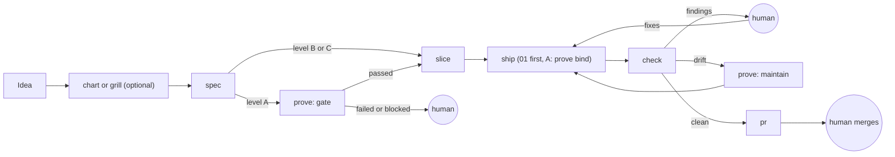

# skills

Agent skills (Agent Skills format: a folder with `SKILL.md`). Most of them form the vflow family for planning and shipping features with verification decided **before** code. Generic by default: any repo, any language, any issue tracker (GitHub Issues by default). A few standalone skills sit beside the family.

## The vflow family

| Skill | Role |
|---|---|
| [`flow`](skills/flow) | Orchestrator: where is this work in the flow, what runs next, tracker adapters, branch and evidence rules |
| [`chart`](skills/chart) | Optional on-ramp for big, foggy, multi-session efforts: a map of decision tickets (adapted from wayfinder) |
| [`grill`](skills/grill) | Interview before the spec for small but fuzzy features: design-tree rounds, glossary and ADRs, a Decision summary with a provisional level (adapted from grilling and domain-modeling) |
| [`spec`](skills/spec) | Spec with a mandatory verification level A/B/C and plain-language invariants (adapted from to-spec) |
| [`prove`](skills/prove) | Formal gate before implementation: TLA+ model checked by TLC plus a statechart; bind and maintain modes |
| [`slice`](skills/slice) | Tracer-bullet tickets, prefactor first, published as sub-issues (adapted from to-tickets) |
| [`ship`](skills/ship) | Implementation: one ticket, or a whole spec as a task graph with a subagent per ticket on an integration branch; tests first from acceptance criteria and INV/PROP (adapted from implement, implement-spec, tdd, diagnosing-bugs) |
| [`check`](skills/check) | QA in three axes side by side: Standards, Spec, Verification (verify skill, acceptance criteria with evidence, drift); then the PR, never the merge (adapted from code-review) |

```
[chart | grill] → spec → prove gate (A) → slice → ship → check → pr
```



`chart` is for multi-session efforts with a foggy route; `grill` is for a one-session feature whose decisions are still open. Both are optional and end in `spec`. `ship` builds ticket 01 (the prefactor) first; `check` stops for the human before any fix and never merges.

Verification levels: **A** state machines, status transitions, concurrency, money (TLA+ gate first); **B** rules and calculations (property-based tests); **C** simple UI/CRUD (regular tests). When unsure, A.

## Other skills (skill lain)

Standalone skills, not part of the vflow flow above. Install them on their own.

| Skill | Role |
|---|---|
| [`pr`](skills/pr) | PR body a reviewer can judge fast: summary with the smallest useful visual, before/after evidence, merge danger; optional INV/PROP section for vflow tickets (adapted from mattpocock/skills pr and HumanLayer show-me). `check` uses it |
| [`lugas`](skills/lugas) | Plain, inclusive Bahasa Indonesia for UI copy, microcopy, guides, docs, reports and public-service text, with the RASA quality lens (Ritmis, Akurat, Sarat Makna, Alami) and a final self-check. Also a compact rule set for everyday agent replies |

To make an agent's everyday replies plain Indonesian (not only when `lugas` is loaded), paste the block from [`skills/lugas/references/agents-snippet.md`](skills/lugas/references/agents-snippet.md) into the repo's `AGENTS.md` or `CLAUDE.md`.

## Install

Copy the eight vflow folders (`flow`, `chart`, `grill`, `spec`, `prove`, `slice`, `ship`, `check`) plus `pr` side by side into your agent's skills directory (for example `.agents/skills/`, `.claude/skills/`, or `.cursor/skills/`). They refer to each other by name; `check` falls back to a built-in PR outline if `pr` is missing. `pr` and `lugas` can be copied alone.

## Requirements (level A only)

- Java 11+ (17/21 recommended) and `tla2tools.jar`: `bash skills/prove/scripts/check_toolchain.sh --fetch-tla2tools`
- `gh` authenticated for the default GitHub Issues tracker
- Python 3 (standard library) for the statechart fallback
- Optional: pstack `statechart` skill (Node 22.18+, mise)

Without Java or TLC the gate is recorded as `blocked`, never skipped silently.

## Configuration

Zero config works. A repo can override defaults with `.vflow.yml` or a `## vflow` section in `AGENTS.md`; a repo tracker doc such as `docs/agents/issue-tracker.md` wins over both. See [`skills/flow/references/config.md`](skills/flow/references/config.md).

## Repo layout

- `skills/`: the installable skills
- `evals/`: trigger and behaviour evals per skill (not installed). Run them with Claude Code via `evals/vtest.py`; see `evals/VTEST.md`.
- `.github/workflows/validate.yml`: frontmatter check and TLC run on the example model

## License

MIT. Derived from [mattpocock/skills](https://github.com/mattpocock/skills), [pstack](https://github.com/cursor/plugins), [obra/superpowers](https://github.com/obra/superpowers) and [HumanLayer show-me](https://github.com/humanlayer/skills) (via `pr`); `lugas` is inspired by the [bahasa-indonesia-plain gist by orepras](https://gist.github.com/orepras/3e1ca8974fc51d11825f142fa6a66635) (no text copied). See [NOTICE.md](NOTICE.md).
