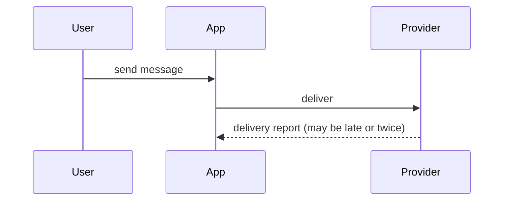

# Summary visuals

The menu of views and the placement guidance come from Dex Horthy's `show-me` skill (HumanLayer, MIT), by way of mattpocock/skills `pr`, aimed here at a diff rather than a live conversation. See `../NOTICE.md`.

Pick the smallest view that makes the key point clear. One is usually enough; several is fine; all of them is too many.

## Logic or an algorithm: pseudocode

```text
on(save)
  if content is unchanged
    return cached result
  write new content
  return fresh result
```

## Runtime control flow: a call tree

```text
submit_form
  create_session
    persist_prompt
    launch_job
  open_session_page
```

## UI structure: a component tree

Include state and module boundaries that matter.

```text
<SessionPage>
  useSessionEvents()
  <Toolbar>
    <RunButton>        (shared ui package)
```

## File responsibility or a broad refactor: a shallow file tree

```text
src/
├── commands/     # parses user actions
├── sessions/     # owns session state
└── transport/    # sends API requests
```

## Interaction or data flow: Mermaid



## What changes inside a known shape: a diff sketch

Match the diff to the topic.

```diff
 <SessionPage>
   <Toolbar>
+    <RunButton />
```

```diff
 src/
 ├── commands/
+│   └── run.ts          # expands the command
-└── transport.ts
+└── transport/
+    ├── client.ts
+    └── stream.ts
```

```diff
 on(save)
-  write content
+  if content is unchanged
+    return cached result
+  write new content
+  invalidate cache
```

## Mostly new code: the whole block

When most of it is new, when leaving context out would hide ownership or order, or when the reader needs a copyable target shape, show the block itself in the repo's language.

## Placement

Put each visual next to the short text it supports. Keep only the calls, files, props, states, and boundaries needed to judge this change.
